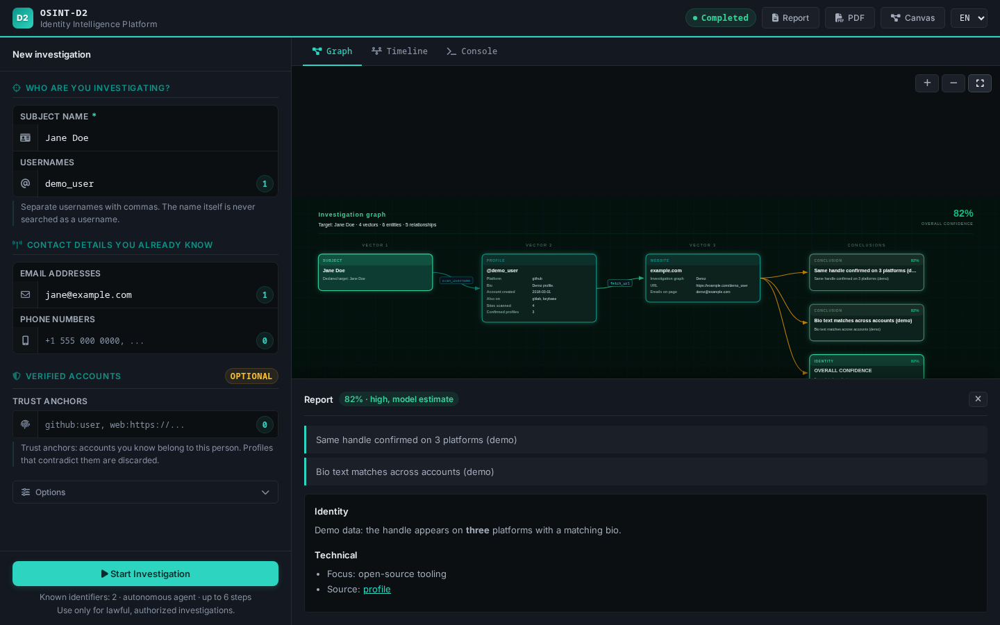
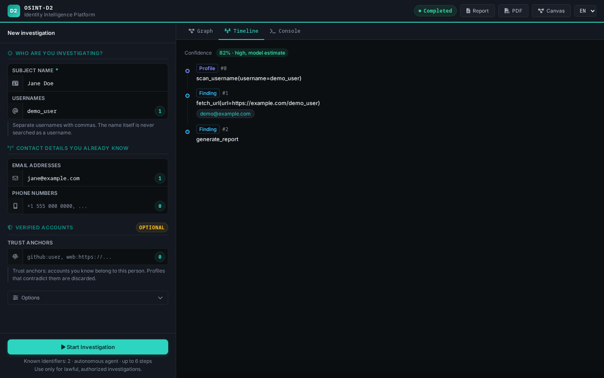

<p align="center">
  
</p>

<h1 align="center">OSINT-D2</h1>

<p align="center">
  <strong>Investigate public identity data with an AI agent that follows leads and documents its evidence.</strong>
</p>

<p align="center">
  <a href="https://github.com/Doble-2/osint-d2/actions/workflows/ci.yml"></a>
  <a href="https://github.com/Doble-2/osint-d2/releases"></a>
  <a href="https://osint-d2.angelcalderon.dev"></a>
  
  <a href="LICENSE"></a>
</p>

> [!IMPORTANT]
> **Use OSINT-D2 only for lawful, authorized investigations.** It collects and infers information about people. Privacy law can apply even to public data, results can be wrong, and scan results are sent to your AI provider unless you use Ollama. Read [Security & Responsible Use](https://osint-d2.angelcalderon.dev/guides/security/) first.

OSINT-D2 is a command-line tool and local web dashboard for security researchers, journalists, and OSINT analysts. Give it a username, email, or phone number, and it checks public sources, separates likely matches from namesakes, and produces a report you can verify.

## What it does

| | |
|---|---|
| **Agent investigations** | An LLM chooses which tools to run, follows new leads such as emails and websites, and writes a report. |
| **Direct scans** | 20 username scanners and 4 email scanners, with optional [Sherlock](https://github.com/sherlock-project/sherlock) (about 470 sites) and site lists. No AI needed. |
| **False-positive filtering** | Declare accounts you already trust (`--trust github:johndoe`). Other profiles are scored on name, bio, avatar, and location, and contradictions are discarded. |
| **Identity correlation** | Compares avatars with perceptual hashing and writing style with character n-grams. |
| **Reports** | PDF dossiers, JSON, and graphs for Obsidian Canvas and HTML. |
| **Choice of AI provider** | DeepSeek, OpenAI, or any OpenAI-compatible API. Use Ollama to keep inference on your machine. |

An agent run looks like this (illustrative, with fictitious data):

```text
Target: johndoe
  scan_username  johndoe            3 confirmed of 20 scanned
  fetch_url      example.com/johndoe  found john@example.com
  scan_email     john@example.com   2 confirmed
  generate_report                   confidence 82% (model estimate)
```

<p align="center">
  
</p>

## Quick start

Direct scans need no API key. Agent runs and AI analysis need one, unless you use Ollama.

### Docker

```bash
git clone https://github.com/Doble-2/osint-d2.git && cd osint-d2
cp .env.example .env     # Add your AI key
mkdir -p reports         # Keeps reports writable by the container
docker compose up -d
```

Open <http://localhost:8000>. To use the CLI, prefix commands with `docker compose exec osint-d2`:

```bash
docker compose exec osint-d2 osint-d2 scan johndoe
```

### Poetry

Requires Python 3.11+, [Poetry](https://python-poetry.org/), and the [Pango libraries](https://osint-d2.angelcalderon.dev/getting-started/installation/#system-dependencies) for PDFs.

```bash
git clone https://github.com/Doble-2/osint-d2.git && cd osint-d2
poetry install
poetry run playwright install chromium
cp .env.example .env     # Add your AI key
poetry run osint-d2 doctor run
poetry run osint-d2 serve
```

### Prebuilt binaries

Download them from [Releases](https://github.com/Doble-2/osint-d2/releases). The [installation guide](https://osint-d2.angelcalderon.dev/getting-started/installation/) lists what they need on your system.

> [!WARNING]
> OSINT-D2 is a local tool: for ethical and legal reasons, the project doesn't operate a hosted version. The dashboard has no authentication by design and listens on localhost. Don't expose it to other people or to the internet.

## Usage

```bash
# Scan a username (no AI)
osint-d2 scan johndoe

# Several targets, with Sherlock
osint-d2 hunt -u johndoe,jdoe123 -e john@example.com --sherlock

# Add AI analysis and a PDF
osint-d2 hunt -u johndoe --ai --export-pdf

# Agent investigation, starting from a trusted account
osint-d2 agent johndoe --trust github:johndoe --max-steps 10

# Machine-readable output (the default when piping)
osint-d2 scan johndoe --format json | jq '.profiles[] | select(.exists)'
```

See the [CLI reference](https://osint-d2.angelcalderon.dev/guides/cli-reference/) for every option.

## Configuration

Set a provider and key in `.env`. The endpoint and model come from the provider unless you override them.

```env
# DeepSeek (default)
OSINT_D2_AI_PROVIDER=deepseek
OSINT_D2_AI_API_KEY=sk-xxxxxxxx

# OpenAI
OSINT_D2_AI_PROVIDER=openai
OSINT_D2_AI_API_KEY=sk-xxxxxxxx

# Ollama (no key needed)
OSINT_D2_AI_PROVIDER=ollama
OSINT_D2_AI_MODEL=llama3.1
```

Inside Docker, Ollama also needs its [container address](https://osint-d2.angelcalderon.dev/guides/docker/#ollama-fully-offline).

Optional services:

- **Breach checks:** set `OSINT_D2_HIBP_API_KEY` to use the official [Have I Been Pwned API](https://haveibeenpwned.com/API/Key), a paid service. It receives the full email address.
- **Proxy:** OSINT-D2 can route scans through ScrapingAnt, a third-party service, using `OSINT_D2_PROXY_API_KEY`.

## Agent tools

| Tool | Purpose |
|------|---------|
| `scan_username` | Check a username across the 20 native scanners |
| `scan_email` | Gravatar and PGP keyservers, with an optional username pivot |
| `breach_check` | Query the official Have I Been Pwned API (optional) |
| `fetch_url` | Extract emails and social links from a page, with SSRF protection |
| `compare_avatars` | Compare images with a perceptual hash (dHash) |
| `scan_phone` | Carrier, country, line type, and WhatsApp status |
| `search_vector_memory` | BM25 keyword search across collected evidence |
| `correlate_stylometry` | Compare writing style with character n-grams |
| `generate_report` | Finish with a report covering six areas |

The report covers identity, geo-temporal signals, personality (OCEAN), technical profile, ideology and values, and attack surface. The personality and ideology sections are speculative inferences, and the confidence score is the model's own estimate. Verify them before relying on them.

## Documentation

- [Installation](https://osint-d2.angelcalderon.dev/getting-started/installation/) and [Quick Start](https://osint-d2.angelcalderon.dev/getting-started/quickstart/)
- [Web Dashboard](https://osint-d2.angelcalderon.dev/guides/web-dashboard/) and [Agent Mode](https://osint-d2.angelcalderon.dev/guides/agent-mode/)
- [Trust Anchors](https://osint-d2.angelcalderon.dev/architecture/trust-anchors/) and [Architecture](https://osint-d2.angelcalderon.dev/architecture/overview/)
- [REST and WebSocket API](https://osint-d2.angelcalderon.dev/api/endpoints/)
- [Security & Responsible Use](https://osint-d2.angelcalderon.dev/guides/security/)

## Contributing

See [CONTRIBUTING.md](CONTRIBUTING.md) and the guide to [adding a scanner](https://osint-d2.angelcalderon.dev/contributing/adding-scanners/).

```bash
poetry install
poetry run pytest
poetry run ruff check .
```

## Disclaimer

OSINT-D2 is intended for authorized security research, journalism, and OSINT investigations. You are responsible for complying with the laws that apply to you. The authors assume no liability for misuse.

## License

[MIT](LICENSE) © Doble-2
