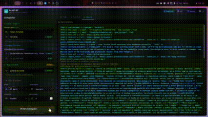
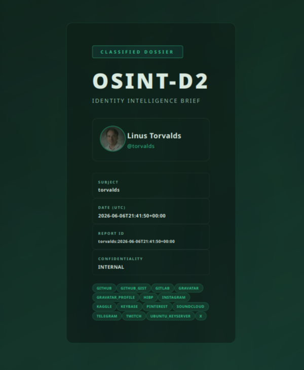

<p align="center">
  
</p>

<h1 align="center">OSINT-D2</h1>

<p align="center">
  <strong>Agentic OSINT • Identity Intelligence • Cognitive Profiling</strong>
</p>

<p align="center">
  <a href="https://osint-d2.angelcalderon.dev"></a>
  <a href="#quick-start"></a>
  <a href="#quick-start"></a>
  <a href="#quick-start"></a>
  <a href="https://scrapingant.com/?ref=odeymdu"></a>
  <a href="LICENSE"></a>
</p>

---

Turn a username into a **structured identity dossier**. Not a Sherlock wrapper — an **autonomous AI agent** that reasons, pivots, and cross-correlates across 30+ platforms.

## What Makes OSINT-D2 Different

Most OSINT tools run a fixed checklist. OSINT-D2 **thinks**:

1. You give it a username or email
2. The AI agent scans it across platforms
3. It discovers new leads (emails, aliases, websites) in the results
4. It **pivots** — investigating those leads autonomously
5. It produces a **6-dimension cognitive profile** grounded in evidence

```
🎯 Username: torvalds
   ↓
🔍 scan_username → GitHub (Linus Torvalds), 11 confirmed / 19 scanned
   ↓
🌐 fetch_url → github.com/torvalds → found emails, social links
   ↓
📧 scan_email → torvalds@linux-foundation.org → 13 confirmed / 23 scanned
   ↓
📧 scan_email → torvalds@kernel.org → 12 confirmed
   ↓
🌐 fetch_url → x.com/torvalds, keybase.io/torvalds
   ↓
🧠 generate_report → 6D cognitive profile distinguishing real Torvalds from impersonators
```

## Core Capabilities

| | Feature | How it works |
|---|---|---|
| 🤖 | **Agentic AI** | ReAct reasoning loop — the LLM decides which tools to invoke, interprets results, and pivots. Forced-report fallback when steps are exhausted. |
| 🔗 | **Identity Triangulation** | Cross-correlates usernames, emails, bios, avatars (perceptual dHash), and writing style (character n-gram stylometry). |
| 🧠 | **6D Cognitive Profiling** | Identity, Geo-temporal, OCEAN Psychology, Tech Stack, Ideology, OpSec/Attack Surface. |
| 🛡️ | **Trust Anchors** | Declare known-good sources (`--trust github:user`). 4-signal weighted scoring (name 40%, bio 30%, avatar 20%, location 10%) filters false positives. |
| 📊 | **PDF Dossiers** | Classified-style intelligence briefs with identity cards, risk matrices, and entity graphs. WeasyPrint + Playwright rendering. |
| 🌍 | **5 Languages** | EN, ES, PT, AR, RU — across CLI, dashboard, AI prompts (the system prompt changes per language), and PDF reports. |
| 🐳 | **Docker** | One-command deployment. Ollama sidecar for fully offline operation. |

<p align="center">
  
</p>

<p align="center">
  
  
</p>

## Quick Start

```bash
# Docker (recommended)
git clone https://github.com/Doble-2/osint-d2.git && cd osint-d2
cp .env.example .env          # Configure: OSINT_D2_AI_API_KEY, OSINT_D2_AI_PROVIDER
docker compose up -d           # Dashboard at http://localhost:8000

# Or with Poetry
poetry install && poetry run playwright install chromium
poetry run osint-d2 serve      # Start the web dashboard
```

### CLI Commands

```bash
# Quick scan across 18+ native scanners
osint-d2 scan johndoe

# Autonomous AI investigation (10 reasoning steps)
osint-d2 agent johndoe --ai-provider deepseek --max-steps 10

# Full pipeline: multiple targets + Sherlock (400+ sites) + breach check
osint-d2 hunt -u johndoe,jdoe123 -e john@example.com --sherlock --breach-check --export-pdf

# Trust anchors to filter false positives
osint-d2 agent johndoe --trust github:johndoe --trust email:john@example.com
```

### AI Providers

```env
# DeepSeek (default, cheapest)
OSINT_D2_AI_PROVIDER=deepseek
OSINT_D2_AI_API_KEY=sk-xxxxxxxx
OSINT_D2_AI_BASE_URL=https://api.deepseek.com

# OpenAI
OSINT_D2_AI_PROVIDER=openai
OSINT_D2_AI_API_KEY=sk-xxxxxxxx
OSINT_D2_AI_MODEL=gpt-4o-mini

# Ollama (fully offline, no API key needed)
OSINT_D2_AI_PROVIDER=ollama
OSINT_D2_AI_BASE_URL=http://localhost:11434/v1
OSINT_D2_AI_MODEL=llama3.1
```

## The 9-Tool Arsenal

The agent has access to 9 tools during investigation:

| Tool | Purpose |
|------|---------|
| `scan_username` | Scan 18+ platforms (GitHub, X, Instagram, Reddit, Telegram, etc.) |
| `scan_email` | Gravatar, PGP keyservers + optional local-part pivot |
| `breach_check` | HaveIBeenPwned k-anonymity check |
| `fetch_url` | Extract intelligence from any URL (SSRF-protected) |
| `compare_avatars` | Perceptual dHash image comparison |
| `scan_phone` | E.164 validation, carrier, country, WhatsApp status |
| `search_vector_memory` | BM25 semantic search across collected evidence |
| `correlate_stylometry` | Character n-gram writing style comparison |
| `generate_report` | Finalize investigation with 6D cognitive profile |

## Documentation

📖 **[osint-d2.angelcalderon.dev](https://osint-d2.angelcalderon.dev)**

- [Installation](https://osint-d2.angelcalderon.dev/getting-started/installation/) — Setup for all platforms
- [Agent Mode](https://osint-d2.angelcalderon.dev/guides/agent-mode/) — Deep dive into the autonomous AI
- [Trust Anchors](https://osint-d2.angelcalderon.dev/architecture/trust-anchors/) — How false positive filtering works
- [Docker Deployment](https://osint-d2.angelcalderon.dev/guides/docker/) — Production setup with Ollama
- [Architecture](https://osint-d2.angelcalderon.dev/architecture/overview/) — Clean Architecture, vector store, rate limiter
- [CLI Reference](https://osint-d2.angelcalderon.dev/guides/cli-reference/) — All commands and flags
- [API Reference](https://osint-d2.angelcalderon.dev/api/endpoints/) — REST + WebSocket endpoints

## Architecture

```
src/
├── core/               # Domain logic (zero I/O)
│   ├── domain/         #   Pydantic models: PersonEntity, SocialProfile, AnalysisReport
│   ├── services/       #   Agent engine, trust anchors, identity pipeline, URL guard
│   └── config.py       #   AppSettings (pydantic-settings, OSINT_D2_* prefix)
├── adapters/           # I/O layer
│   ├── osint_sources/  #   21 platform-specific scanners
│   ├── vector_store.py #   Pure-Python BM25 + stylometry engine
│   ├── rate_limiter.py #   Per-domain throttle with jitter
│   ├── web_server.py   #   FastAPI + WebSocket dashboard
│   └── report_*.py     #   PDF/HTML dossier generation
└── cli/                # Typer + Rich CLI interface
```

## Contributing

See [CONTRIBUTING.md](CONTRIBUTING.md) for guidelines.

```bash
poetry install --with dev
poetry run pytest
poetry run ruff check .
```

## Disclaimer

This tool is designed for **authorized security research**, **journalism**, and **OSINT investigations** only. Users are responsible for complying with all applicable laws and regulations. The authors assume no liability for misuse.

## License

[MIT](LICENSE) © Doble-2
