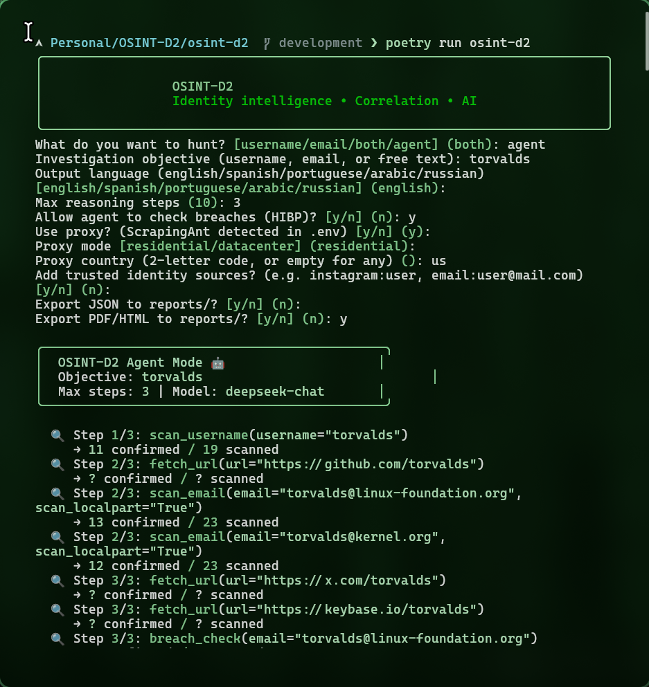

<p align="center">
  
</p>

<h1 align="center">OSINT-D2</h1>

<p align="center">
  <strong>Agentic OSINT • Identity Intelligence • Cognitive Profiling</strong>
</p>

<p align="center">
  <a href="https://osint-d2.angelcalderon.dev"></a>
  <a href="#quick-start"></a>
  <a href="#quick-start"></a>
  <a href="#quick-start"></a>
  <a href="https://scrapingant.com/?ref=odeymdu"></a>
  <a href="LICENSE"></a>
</p>

---

OSINT-D2 is an **advanced open-source intelligence platform** that transforms usernames and emails into structured identity dossiers. Powered by **agentic AI** with autonomous function calling, it delivers identity correlation, cognitive profiling, and breach analysis — all from a single command.

## Key Features

| | Feature | Description |
|---|---|---|
| 🤖 | **Agentic AI** | Autonomous investigation — the LLM decides which tools to invoke and pivots across identities |
| 🔍 | **Multi-source Correlation** | Links usernames, emails, and aliases across 30+ platforms |
| 🧠 | **6D Cognitive Profiling** | Identity, Geo-temporal, OCEAN psychology, Tech, Ideology, OpSec |
| 🛡️ | **Trust Anchors** | Verified identity sources to filter false positives |
| 📊 | **PDF Dossiers** | Classified-style reports with identity cards, OCEAN profiles, and risk matrices |
| 🌍 | **5 Languages** | English, Spanish, Portuguese, Arabic, Russian — UI, AI, and reports |
| 🐳 | **Docker Ready** | One-command deployment: `docker compose up -d` |

## Quick Start

```bash
# Docker (recommended)
git clone https://github.com/Doble-2/osint-d2.git && cd osint-d2
cp .env.example .env          # Add your API keys
docker compose up -d           # http://localhost:8000

# Or with Poetry
poetry install && playwright install chromium
poetry run osint-d2 serve
```

## Documentation

📖 **Full documentation** → **[osint-d2.angelcalderon.dev](https://osint-d2.angelcalderon.dev)**

- [Installation Guide](https://osint-d2.angelcalderon.dev/getting-started/installation/)
- [Docker Deployment](https://osint-d2.angelcalderon.dev/guides/docker/)
- [CLI Reference](https://osint-d2.angelcalderon.dev/guides/cli-reference/)
- [Agent Mode](https://osint-d2.angelcalderon.dev/guides/agent-mode/)
- [API Reference](https://osint-d2.angelcalderon.dev/api/endpoints/)
- [Architecture](https://osint-d2.angelcalderon.dev/architecture/overview/)

## Architecture

```
src/
├── core/         # Domain models, services, business logic
├── adapters/     # Scanners, AI, exporters, web server
└── cli/          # Typer CLI interface
```

Clean Architecture with clear separation between domain logic and external adapters. See the [full architecture docs](https://osint-d2.angelcalderon.dev/architecture/overview/).

## Contributing

See [CONTRIBUTING.md](CONTRIBUTING.md) for guidelines. Development setup:

```bash
poetry install --with dev
poetry run pytest
poetry run ruff check .
```

## Disclaimer

This tool is designed for **authorized security research**, **journalism**, and **OSINT investigations** only. Users are responsible for complying with all applicable laws and regulations. The authors assume no liability for misuse.

## License

[MIT](LICENSE) © Doble-2
