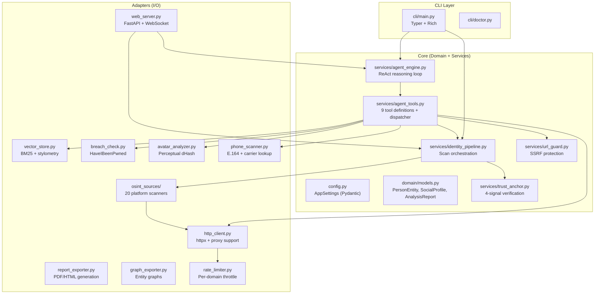

# Architecture Overview

OSINT-D2 is inspired by Clean Architecture, separating domain logic from I/O adapters. The codebase is organized into three layers.

---

## Core

The core holds the domain models and orchestration. Most I/O lives in adapters, but the separation isn't strict yet: `core/services` imports adapters directly, and `agent_tools.py` and `resources_loader.py` make HTTP requests.

### Domain Models (`core/domain/models.py`)

Three Pydantic v2 models define the investigation data:

| Model | Purpose |
|-------|---------|
| **`PersonEntity`** | Root aggregate: target identifier + discovered profiles + optional AI analysis |
| **`SocialProfile`** | One profile on one platform: URL, username, network, exists flag, bio, avatar, metadata dict |
| **`AnalysisReport`** | AI-generated analysis: summary, highlights, confidence score, model used, raw payload |

Additional models: `HaveibeenpwnedBreach`, `HaveibeenpwnedProfiles` for breach data.

### Agent Engine (`core/services/agent_engine.py`)

The ReAct reasoning loop. See [Agent Mode](../guides/agent-mode.md) for details.

Key decisions:
- Uses the **OpenAI client** (compatible with DeepSeek, Ollama, Groq, any OpenAI-compatible API)
- **Forced report fallback**: if the agent exhausts steps, forces `generate_report` with `tool_choice`
- **Profile collection**: every tool result is parsed for `SocialProfile`-like entries and indexed into the vector store
- **Explicit target**: the target identifier is set by the caller (CLI/web), never guessed from the free-text objective

### Trust Anchor Verification (`core/services/trust_anchor.py`)

4-signal weighted identity verification. See [Trust Anchor System](trust-anchors.md) for the full deep-dive.

### URL Guard (`core/services/url_guard.py`)

SSRF protection for the `fetch_url` agent tool. Blocks requests to:
- Private IP ranges (`10.x.x.x`, `172.16.x.x`, `192.168.x.x`)
- Loopback (`127.0.0.1`, `localhost`)
- Link-local (`169.254.x.x`)
- Cloud IMDS endpoints (`169.254.169.254`)

---

## Adapters

### Platform Scanners (`adapters/osint_sources/`)

20 dedicated scanners, each implementing platform-specific extraction:

| Scanner | Method | Extracted data |
|---------|--------|----------------|
| GitHub | REST API | Name, bio, location, email, repos, blog, Twitter link |
| GitLab | REST API | Name, bio, avatar |
| Instagram | Web scraping + OG tags | Name, bio, followers, avatar |
| Facebook | mbasic.facebook.com | Name, location, education |
| X (Twitter) | Web scraping | Bio, followers, avatar |
| Telegram | t.me | Display name, bio, avatar |
| Reddit | JSON API | Karma, cake day, bio |
| Medium | REST API | Name, bio, avatar |
| Pinterest | Web scraping | Name, bio, boards count |
| Twitch | GQL API | Display name, bio, avatar |
| + 10 more | Various | Platform-specific metadata |

Additionally, **data-driven site lists** (WhatsMyName format) extend coverage to hundreds of additional sites without dedicated scrapers.

### Vector Store (`adapters/vector_store.py`)

Pure-Python in-memory search engine with two capabilities:

1. **Semantic search** (BM25): retrieve previously collected evidence by concept
2. **Stylometric correlation**: compare writing styles using character n-gram cosine similarity

Technical details:
- **No heavy deps**: no numpy, scipy, or ML frameworks. Sparse dicts + math only.
- **Trilingual stemming**: light suffix stripping for Spanish, English, Portuguese
- **Accent folding**: Unicode NFD normalization strips diacritics
- **BM25 parameters**: `k1=1.5` (term frequency saturation), `b=0.75` (document length normalization)
- **Stylometry guard**: minimum 40 characters to prevent false certainty from short texts

### Rate Limiter (`adapters/rate_limiter.py`)

Responsible scanning with per-domain throttling:

| Setting | Default | Env Var |
|---------|---------|---------|
| Delay between requests | 200ms | `OSINT_D2_REQUEST_DELAY_MS` |
| Jitter | ±100ms | `OSINT_D2_REQUEST_JITTER_MS` |
| Per-domain concurrency | 3 | `OSINT_D2_PER_DOMAIN_CONCURRENCY` |
| Retry attempts (429/503) | 3 | `OSINT_D2_RETRY_MAX_ATTEMPTS` |
| Global concurrency | 30 | `OSINT_D2_SITES_MAX_CONCURRENCY` |

Exponential backoff with jitter on 429/503 responses.

### Report Exporter (`adapters/report_exporter.py`)

Generates classified-style PDF dossiers with:
- Identity card with avatar, classification level, and evidence tags
- 6D cognitive profile sections
- Entity relationship graph
- Risk/confidence matrix
- Full evidence appendix

The CLI renders **Jinja2 HTML → WeasyPrint → PDF**, and saves the HTML if WeasyPrint fails. The dashboard renders the same HTML with **Playwright** (headless Chromium), adding the graph page.

### Avatar Analyzer (`adapters/avatar_analyzer.py`)

Perceptual image comparison using **difference hash (dHash)**:
1. Resize to 9x8 grayscale
2. Compare adjacent pixels to generate 64-bit hash
3. Hamming distance between hashes = dissimilarity

Robust to JPEG compression, resizing, and minor color adjustments. Used by the agent's `compare_avatars` tool.

### HTTP Client (`adapters/http_client.py`)

Centralized `httpx.AsyncClient` factory with:
- Configurable proxy support (ScrapingAnt residential/datacenter)
- Custom User-Agent
- Timeout management
- HTML metadata extraction (title, description, social links, emails in page)

---

## Configuration (`core/config.py`)

All configuration via `pydantic-settings` with the `OSINT_D2_` prefix:

- **Resolution order**: env vars → user `~/.config/osint-d2/.env` → project `.env`
- **Cross-platform**: Windows (`%APPDATA%`), macOS (`~/Library/Application Support`), Linux (`~/.config`)
- **Typed validation**: Pydantic enforces types, ranges, and constraints at startup
