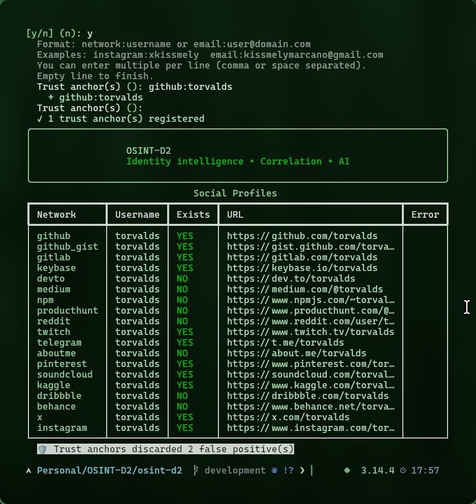

# Quick Start

This guide walks you through your first OSINT investigation. In 5 minutes you'll go from a username to a structured intelligence dossier.

---

## Your First Investigation

### 1. Start the interactive CLI

```bash
poetry run osint-d2
```

You'll see the OSINT-D2 banner and a guided wizard:

<div class="os-screenshot" markdown>


<div class="os-screenshot__caption">Interactive CLI — the wizard guides you through investigation options</div>

</div>

### 2. Choose an investigation mode

| Mode | What it does | Speed | Depth |
|------|-------------|-------|-------|
| **username** | Scan a username across 18+ native scanners | ~15s | Surface-level profiles |
| **email** | Scan email via Gravatar, PGP keyservers + optional local-part pivot | ~20s | Email-linked accounts |
| **both** | Combined username + email scan | ~30s | Broader coverage |
| **agent** | Autonomous AI agent that reasons, pivots, and cross-correlates | ~2-5min | Deep — 6D cognitive profile |

### 3. Review results

After scanning, OSINT-D2 displays:

- **Social profiles table** with confirmation status (YES/NO per platform)
- **AI analysis** with the 6-dimension cognitive profile (Agent Mode only)
- **Optional exports**: JSON, PDF dossier, HTML report

<div class="os-screenshot" markdown>


<div class="os-screenshot__caption">Scan results with trust anchor verification filtering false positives</div>

</div>

---

## Direct Commands (Non-Interactive)

For scripting or quick lookups, use direct CLI commands:

```bash
# Quick username scan
osint-d2 scan -u johndoe

# Scan multiple usernames + emails
osint-d2 hunt -u johndoe,jdoe123 -e john@example.com

# Full autonomous investigation
osint-d2 agent -u johndoe --provider deepseek --max-steps 10

# Scan + Sherlock (400+ sites) + breach check
osint-d2 hunt -u johndoe --sherlock --breach
```

### Export Results

```bash
# Export as JSON
osint-d2 hunt -u johndoe --json

# Export as PDF dossier (classified-style)
osint-d2 hunt -u johndoe --pdf

# Both
osint-d2 agent -u johndoe --json --pdf --max-steps 10
```

<div class="os-screenshot" markdown>


<div class="os-screenshot__caption">Classified-style PDF dossier with identity card, trust tags, and evidence summary</div>

</div>

---

## Web Dashboard

For a visual interface with real-time investigation streaming:

```bash
osint-d2 serve
# or
docker compose up -d
```

Open **http://localhost:8000** in your browser. See the [Web Dashboard guide](../guides/web-dashboard.md) for details.

---

## What's Next?

- [:material-robot: Agent Mode](../guides/agent-mode.md) — Deep dive into the autonomous AI agent
- [:material-shield-check: Trust Anchors](../architecture/trust-anchors.md) — Eliminate false positives
- [:material-docker: Docker Deployment](../guides/docker.md) — Production setup
- [:material-console: CLI Reference](../guides/cli-reference.md) — All commands and flags
