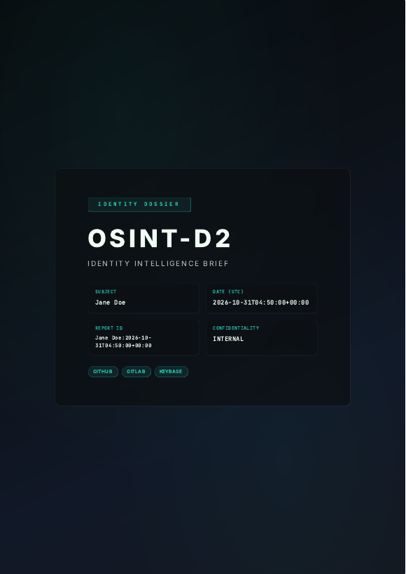

# Quick Start

This tutorial takes you from installation to your first result, then to an AI-assisted investigation. Direct scans need no API key.

!!! warning "Before you start"
    Only investigate where you have a lawful basis and, where required, authorization. Practice on a username of your own. See [Security & Responsible Use](../guides/security.md).

This guide assumes a [Poetry installation](installation.md). With Docker, replace `poetry run` with `docker compose exec osint-d2`.

## 1. Check your setup

```bash
poetry run osint-d2 doctor run
```

The table shows what works, and what to do about anything that doesn't. A missing AI key is fine for now.

## 2. Run your first scan

```bash
poetry run osint-d2 scan your-username
```

You get a table with one row per source: `Exists` says whether the profile was found. Expect some false positives, because other people may use the same handle.

!!! tip "If a source shows an error"
    Some platforms block automated requests. The scan continues with the others, and the error appears in that row.

## 3. Remove false positives

Tell OSINT-D2 which account you know is yours. Profiles that contradict it are discarded:

```bash
poetry run osint-d2 scan your-username --trust github:your-username
```

## 4. Save the results

```bash
poetry run osint-d2 hunt -u your-username --export-json --export-pdf
```

Files are saved to `reports/` in the current directory. They contain personal data, so store and delete them with care.

<div class="os-screenshot" markdown>

{ width="420" }
<div class="os-screenshot__caption">PDF dossier (demo data)</div>

</div>

## 5. Run an agent investigation

Agent mode needs an AI provider, and sends scan results to it unless you use Ollama. Add your provider to `.env`:

```env
OSINT_D2_AI_PROVIDER=deepseek
OSINT_D2_AI_API_KEY=sk-your-key
```

Then run:

```bash
poetry run osint-d2 agent your-username --trust github:your-username --max-steps 6
```

Each tool call appears as it runs, followed by the report. Treat the report as a set of leads to verify. See [Agent Mode](../guides/agent-mode.md).

## 6. Try the dashboard

```bash
poetry run osint-d2 serve
```

Open <http://127.0.0.1:8000>. See the [Web Dashboard guide](../guides/web-dashboard.md).

## Commands at a glance

| Command | Use it for | AI |
|---------|-----------|----|
| `scan` | One username | Optional (`--deep-analyze`) |
| `scan-email` | One email | Optional (`--deep-analyze`) |
| `hunt` | Several targets, Sherlock, site lists, breach checks | Optional (`--ai`) |
| `agent` | Autonomous investigation | Required |
| `analyze` | AI analysis of a saved JSON file | Falls back to a local heuristic without a key |
| `phone` | Phone number lookup | No |
| `wizard` | Guided prompts | Depends on the choices |

## Troubleshooting

| Problem | Fix |
|---------|-----|
| `Agent mode needs an AI provider key` | Set `OSINT_D2_AI_API_KEY`, run `osint-d2 doctor setup-ai`, or use Ollama |
| `command not found: osint-d2` | Use `poetry run osint-d2`, or activate the environment with `poetry env activate` |
| PDF export creates an HTML file | Install the [system libraries](installation.md#system-dependencies), then run `doctor run` |
| `--breach-check requires a HaveIBeenPwned API key` | Set `OSINT_D2_HIBP_API_KEY`, or remove the flag |
| A setting seems to be ignored | The user config overrides the project `.env`. See [precedence](configuration.md#where-settings-come-from) |
| Output is JSON instead of a table | Output is being piped. Add `--format table` |
