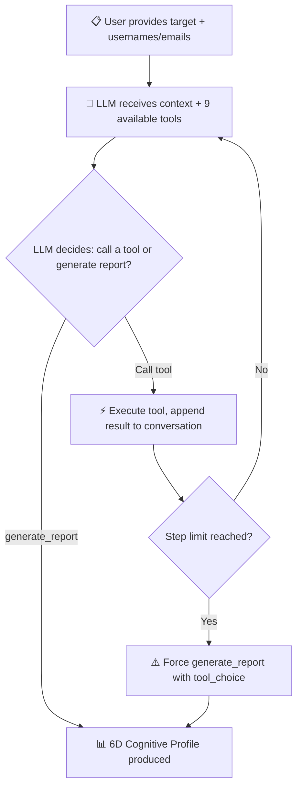

# Agent Mode

OSINT-D2's Agent Mode is the core differentiator: an **autonomous AI investigator** that uses LLM function calling to reason about evidence, decide what to scan next, and pivot across identities — just like a human analyst, but faster.

!!! abstract "Not a script — an agent"
    Most OSINT tools run a fixed pipeline. Agent Mode uses a **ReAct reasoning loop**: the AI observes evidence, thinks about what's missing, calls a tool, and repeats until it has enough to build a cognitive profile.

## How the ReAct Loop Works



Each step, the LLM receives the **full conversation history** (system prompt + all previous tool calls and results) and decides autonomously what to do next. The engine (`agent_engine.py`) manages the loop, collects discovered profiles, and indexes them into the in-memory vector store for cross-reference.

### Forced Report Fallback

If the agent exhausts its `max_steps` without calling `generate_report`, the engine forces one final LLM call with `tool_choice={"type": "function", "function": {"name": "generate_report"}}` — guaranteeing every investigation produces a structured output, even if the agent was too eager investigating.

---

## The 9-Tool Arsenal

The agent has access to 9 tools, each wrapping an existing OSINT scanner and compacting results to fit the LLM context window.

| # | Tool | What it does | Key output |
|---|------|-------------|------------|
| 1 | `scan_username` | Check the 20 native username scanners (GitHub, X, Instagram, Reddit, Telegram, etc.) | Confirmed profiles with bios, avatars, metadata |
| 2 | `scan_email` | Pivot from email via Gravatar, PGP keyservers, Ubuntu keyserver. Optionally scans local part as username. | Cross-platform profiles, PGP keys |
| 3 | `breach_check` | Official HaveIBeenPwned API. Requires `OSINT_D2_HIBP_API_KEY` and sends the full email to HIBP | Breach names, dates, compromised data types |
| 4 | `fetch_url` | Extract intelligence from any URL: title, emails, social links, OG metadata | Discovered usernames, emails, social links |
| 5 | `compare_avatars` | Perceptual hashing (dHash) to compare two avatar images | Similarity %, hamming distance |
| 6 | `scan_phone` | Telecom intelligence: E.164 validation, carrier, country, WhatsApp status | Carrier, line type, timezones, footprint URLs |
| 7 | `search_vector_memory` | BM25 search across all evidence collected during the investigation | Ranked snippets with relevance scores |
| 8 | `correlate_stylometry` | Character n-gram stylometric comparison against known target writing | Cosine similarity (0-1) per candidate |
| 9 | `generate_report` | Finalize investigation with structured 6D analysis | Summary, highlights, confidence score |

### SSRF Protection

`fetch_url` and `compare_avatars` validate each URL, including every redirect, against private, reserved, and cloud metadata addresses. See the [known limits](security.md#known-limits).

---

## Score Interpretation

!!! danger "Critical — do not misread these"
    The agent's system prompt explicitly instructs the LLM how to interpret each scoring metric. Misinterpretation leads to false conclusions in the final report.

### `search_vector_memory` → BM25 Score

| Range | Meaning |
|-------|---------|
| **0 – 1** | Weak match — few overlapping terms |
| **1 – 3** | Moderate match — relevant content |
| **3 – 5+** | Strong match — highly relevant |

BM25 scores are **not percentages**. They depend on corpus size, document length, and term frequency saturation (`k1=1.5`, `b=0.75`). A score of 4.2 means "very relevant", not "42%".

### `correlate_stylometry` → Cosine Similarity

| Range | Interpretation |
|-------|---------------|
| **> 0.70** | Very likely the same author |
| **0.40 – 0.70** | Moderate signal — needs corroboration |
| **< 0.15** | Unrelated writing styles |

Based on character 4-gram frequency vectors with accent folding (`Calderón` → `Calderon`). **Minimum 40 characters** required — shorter samples are silently skipped to avoid false certainty.

### `compare_avatars` → Perceptual Hash

| Metric | Interpretation |
|--------|---------------|
| `hamming_distance = 0` | Identical images |
| `hamming_distance ≤ 10` | Probably the same photo (resized, recompressed) |
| `hamming_distance > 20` | Different images |
| `similarity_percentage` | 0–100% based on hamming distance |

Uses difference hash (dHash) which is robust to JPEG compression, resizing, and minor color adjustments.

---

## Vector Memory Architecture

During an investigation, every discovered profile with text content (bios, descriptions, titles) is indexed into an **in-memory vector store**. This allows the agent to cross-reference evidence later.

```
Profile discovered → tokenize (accent fold + trilingual stem) → TF-IDF vector
                                                               → character 4-gram stylometric vector
                     → index in BM25 store
```

The vector store is **pure Python** (no numpy/scipy dependency):

- **Accent folding**: `unicodedata.normalize("NFD")` strips diacritics so `calderón` matches `calderon`
- **Trilingual stemming**: Light suffix stripping for Spanish, English, and Portuguese (`desarrollo` → `desarr`, `developer` → `develop`)
- **Stopword removal**: 150+ stopwords across ES/EN/PT
- **BM25 scoring**: Length-normalized term frequency with IDF weighting (not cosine similarity, which penalized long documents)

---

## System Prompt Strategy

The agent's system prompt exists in English and Spanish, and other languages use the English version. It includes:

1. **Role definition** — "expert OSINT investigator and Criminal Profiler"
2. **Method** — 5-step investigation methodology (start → gather → analyze → pivot → report)
3. **Rules** — step limits, no data fabrication, treating tool results as untrusted data
4. **Score interpretation** — explicit instructions for BM25, stylometry, and avatar metrics
5. **Report structure** — must cover the 6 dimensions
6. **Language** — response language matches the investigation

In Spanish, the agent receives instructions in Spanish and responds in "español neutro".

---

## Configuration

### CLI

```bash
osint-d2 agent johndoe --ai-provider deepseek --max-steps 10
```

### Web Dashboard

Select **AI Agent** mode in the sidebar configuration, set the AI provider and max steps, then click **Start Investigation**.

### Environment

```env
OSINT_D2_AGENT_MAX_STEPS=10       # Default max reasoning steps
OSINT_D2_AI_PROVIDER=deepseek     # Sets the default endpoint and model
OSINT_D2_AI_API_KEY=sk-...        # Not needed for Ollama
```

| Provider | Base URL | Model |
|----------|----------|-------|
| DeepSeek | `https://api.deepseek.com` | `deepseek-chat` |
| OpenAI | `https://api.openai.com/v1` | `gpt-4o-mini` |
| Ollama | `http://localhost:11434/v1` | `llama3` |
| Groq | `https://api.groq.com/openai/v1` | `openai/gpt-oss-120b` |

---

## 6D Cognitive Profile

When the agent finishes, it generates a structured analysis across 6 dimensions:

| Dimension | What the agent analyzes |
|-----------|------------------------|
| **Identity & Demographics** | Real name, aliases, handle patterns, estimated age, gender, education level. Cross-references names across platforms to identify impersonators. |
| **Geo-temporal** | Timezone inference, location signals, language patterns, activity hours, sleep routine estimation |
| **OCEAN Psychology** | Big Five personality traits inferred from writing style, content choices, and online behavior patterns |
| **Tech Stack** | Programming languages, frameworks, tools, platforms, contribution patterns, skill level indicators |
| **Ideology & Values** | Interests, causes, community affiliations, political signals, content themes |
| **OpSec / Attack Surface** | Password reuse signals, email exposure, handle consistency, data breach exposure, privacy hygiene |

!!! warning "Treat the profile as unverified"
    The personality, ideology, and demographic sections are the model's inferences, not established facts. They can be wrong, and they touch categories that privacy law may specially protect. See [Responsible Use](security.md#responsible-use).

---

## Tips

- **More steps = deeper investigation** — 6 for quick scans, 10-15 for thorough investigations
- **Trust anchors** filter false positives — `--trust github:johndoe` tells the agent that GitHub profile is confirmed
- **Ollama** keeps inference on your machine, but the scans still contact the target sites
- **Check the evidence** — the prompt forbids inventing data, but models can still make mistakes
- **Parallel tool calls**: some LLMs (GPT-4o) call multiple tools per step, making investigations faster
