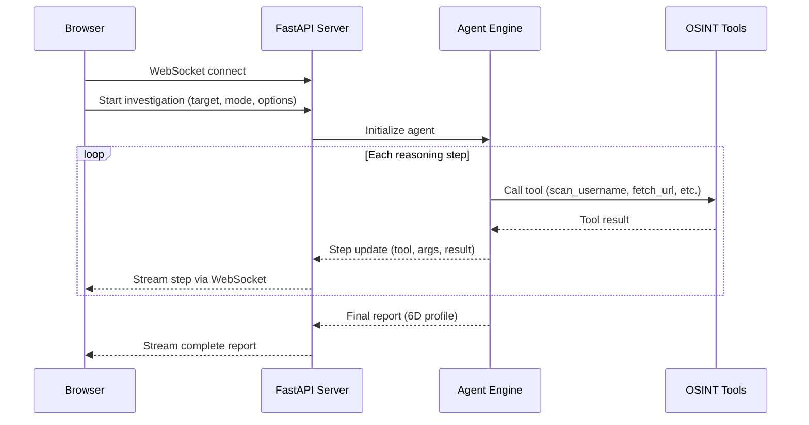
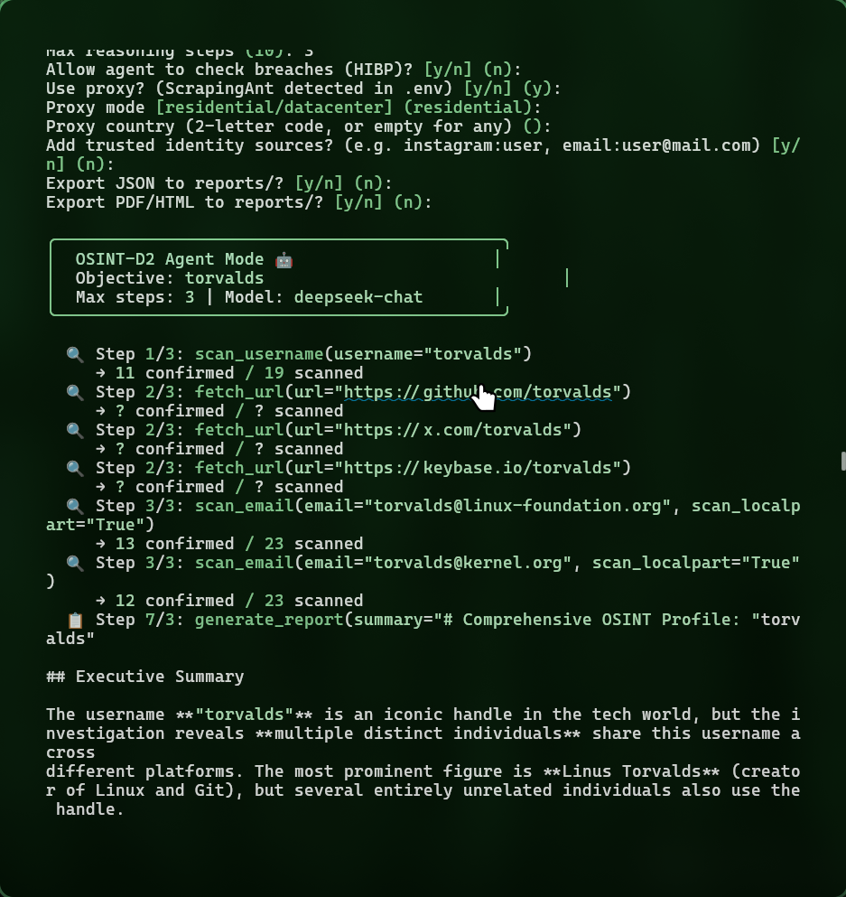

# Web Dashboard

The web dashboard provides a real-time visual interface for OSINT investigations, powered by WebSocket streaming from the FastAPI backend.

```bash
osint-d2 serve              # Start dashboard at http://localhost:8000
# or
docker compose up -d         # Docker deployment
```

---

## Interface

<div class="os-screenshot" markdown>


<div class="os-screenshot__caption">Investigation wizard with real-time agent reasoning</div>

</div>

The dashboard is a single-page application built with vanilla JavaScript and the OSINT-D2 design system (dark intelligence theme). It communicates with the backend entirely via WebSocket.

!!! info "Offline & Private"
    The dashboard makes **zero external network requests**. All JavaScript (vis-network, DOMPurify) and CSS (Font Awesome) dependencies are vendorized locally. No CDNs, no telemetry, no data leaks — suitable for air-gapped and sensitive environments.

### Key Components

| Component | What it shows |
|-----------|--------------|
| **Investigation Panel** | Configure target, mode, language, trust anchors, AI provider |
| **Agent Console** | Real-time streaming of agent reasoning steps and tool calls |
| **Social Profiles Table** | Discovered profiles with confirmation status, avatars, and metadata |
| **Entity Graph** | Interactive relationship visualization between identities |
| **AI Analysis** | Full 6D cognitive profile when using Agent Mode |
| **Export Actions** | Download JSON, PDF dossier, or HTML report |

---

## Real-Time Architecture

The dashboard uses a **WebSocket connection** to stream investigation progress:



Each agent step is pushed to the browser **as it happens** — you can watch the AI reason in real time.

---

## Investigation Modes

### Quick Scan

Select **Username** or **Email** mode for a fast scan across native scanners. Results appear in the social profiles table within seconds.

### Agent Mode

Select **AI Agent** for autonomous investigation:

1. Set the **AI provider** (DeepSeek, OpenAI, Ollama)
2. Set **max reasoning steps** (default: 10)
3. Optionally enable **breach checking**
4. Optionally add **trust anchors** to filter false positives
5. Click **Start Investigation**

<div class="os-screenshot" markdown>


<div class="os-screenshot__caption">Agent reasoning steps streamed in real time</div>

</div>

---

## Entity Graph

The dashboard renders an interactive entity graph showing relationships between discovered identities:

- **Green node** — the investigation target
- **Cyan nodes** — confirmed profiles (exists = YES)
- **Grey nodes** — unconfirmed or non-existent profiles
- **Red markers** — profiles with breach data
- **Edges** — connection type (username match, email link, avatar match)

---

## Language Support

Switch languages via the sidebar dropdown or URL parameter:

```
http://localhost:8000/?lang=es
```

The dashboard UI, AI prompts, and PDF exports all adapt to the selected language. See [Languages](languages.md) for supported languages.

---

## Configuration

| Setting | Where | Options |
|---------|-------|---------|
| AI Provider | Sidebar | DeepSeek, OpenAI, Ollama |
| Max Steps | Sidebar | 1-20 (default: 10) |
| Breach Check | Sidebar toggle | On/Off |
| Trust Anchors | Sidebar input | `network:username` format |
| Proxy | `.env` file | ScrapingAnt residential/datacenter |
| Language | Sidebar dropdown | en, es, pt, ar, ru |
