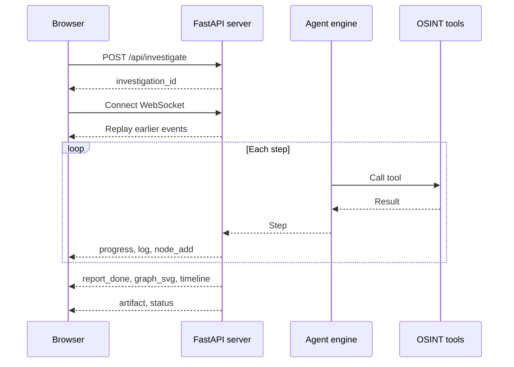

# Web Dashboard

The dashboard is a local web interface for agent investigations. It streams each step over a WebSocket and lets you download the results when the run finishes.

```bash
osint-d2 serve              # http://127.0.0.1:8000
# or
docker compose up -d        # http://localhost:8000
```

!!! warning "Local tool"
    The dashboard is meant to run on your own machine, and has no authentication by design. Both commands above listen on loopback only. See [Security & Responsible Use](security.md).

<div class="os-screenshot" markdown>


<div class="os-screenshot__caption">Finished investigation with the report panel open (demo data)</div>

</div>

---

## Run an investigation

1. Enter the **subject name**. It is required, and it is treated as a person's name, never scanned as a username.
2. Add what you already know: **usernames**, **emails**, and **phone numbers**, separated by commas.
3. Optionally add **verified accounts** (trust anchors) such as `github:johndoe` or `email:john@example.com`. They give the agent a verified starting point. Without them, attributions are marked as unconfirmed.
4. Open **Options** to change the mode, AI provider, report language, step limit, or breach check.
5. Click **Start Investigation**, or press ++enter++ in any field.

The top bar shows the status and a progress bar. The **Console** tab shows the current step, such as `Step 2 / 6`. **Cancel** stops the run immediately.

You can reload the page or change the language at any time: the form stays filled in, and a run in progress reconnects. The status **Completed with errors** means a tool failed or a file could not be created, so check the console.

On small screens the form collapses when a run starts. Use the arrow next to **New investigation** to reopen it.

### Options

| Option | Values | Default |
|--------|--------|---------|
| Mode | **AI Agent**, **Telecom** | AI Agent |
| AI provider | DeepSeek, OpenAI, Ollama | `OSINT_D2_AI_PROVIDER` |
| Language | `en`, `es`, `pt`, `ar`, `ru` | Interface language |
| Max steps | 3–15 | 6 |
| Breach check | On, Off (requires `OSINT_D2_HIBP_API_KEY`) | Off |

**Telecom** mode only looks up the phone numbers you enter. It does not use the AI agent and produces no files.

!!! note "API keys belong to one provider"
    The dashboard sends `OSINT_D2_AI_API_KEY` only to the provider set in `OSINT_D2_AI_PROVIDER`. Selecting a different provider runs without that key, so hosted providers fail with a configuration error until you change `.env`. Ollama needs no key.

---

## Read the results

### Graph

Nodes appear as the agent works. When the run finishes, they are replaced by the final graph: each vertical band is an investigation vector, and the last band holds the conclusions.

To explore it, drag or use the arrow keys to move, and use the wheel, a pinch, the buttons, or ++plus++ and ++minus++ to zoom. ++0++ fits the whole graph.

Handles that look like common first names are labeled as probable false positives.

### Timeline

<div class="os-screenshot" markdown>


<div class="os-screenshot__caption">Each tool call the agent made, in order (demo data)</div>

</div>

The timeline appears when the run finishes.

### Console

The console logs each step as it happens, along with warnings and errors.

### Report

The report panel opens automatically when the agent finishes. Close it with **×** or ++esc++, and reopen it with **Report** in the top bar.

The confidence score is colored by level, but it's the model's own estimate, not a measured probability. Check the evidence before relying on a finding.

### Downloads

| Button | File |
|--------|------|
| **PDF** | Dossier with the graph page |
| **Canvas** | Graph for [Obsidian Canvas](https://obsidian.md/canvas) |

A button appears only once its file exists. Copies, plus the HTML, SVG, and PNG versions, are saved to `reports/`.

---

## Languages

Change the interface with the selector in the top bar or with `?lang=`:

```
http://localhost:8000/?lang=ar
```

Arabic uses a right-to-left layout. See [Languages](languages.md) for what each language covers.

---

## Troubleshooting

| What you see | Cause | Fix |
|--------------|-------|-----|
| Yellow "No API key" notice | No key for the selected provider | Set `OSINT_D2_AI_API_KEY` and `OSINT_D2_AI_PROVIDER` in `.env`, restart, or choose Ollama |
| **Failed** with `LLM error: 401` | The provider rejected the key | Check that the key matches the provider, then restart the server |
| **Failed** with a connection error on Ollama | Ollama is unreachable | Start Ollama. In Docker, set `OSINT_D2_AI_BASE_URL=http://ollama:11434/v1` |
| `Too many investigations running` | 5 runs are already active | Wait for one to finish, or cancel it |
| **Completed with errors** | A tool failed, the model stopped early, or a file failed | Read the warnings in the console. The dossier contains what was gathered |
| No **PDF** button after finishing | Chromium could not render it | Run `playwright install chromium` and read the error in the console |
| The results disappear after a server restart | Sessions are kept in memory | The files are still in `reports/` |

---

## How it works



The dashboard loads all its scripts, styles, and fonts from the local server, so the page itself needs no CDN. Investigations still contact the scanned sites and, unless you use Ollama, your AI provider.

For integrations, see the [REST API](../api/endpoints.md) and the [WebSocket protocol](../api/websocket.md).
