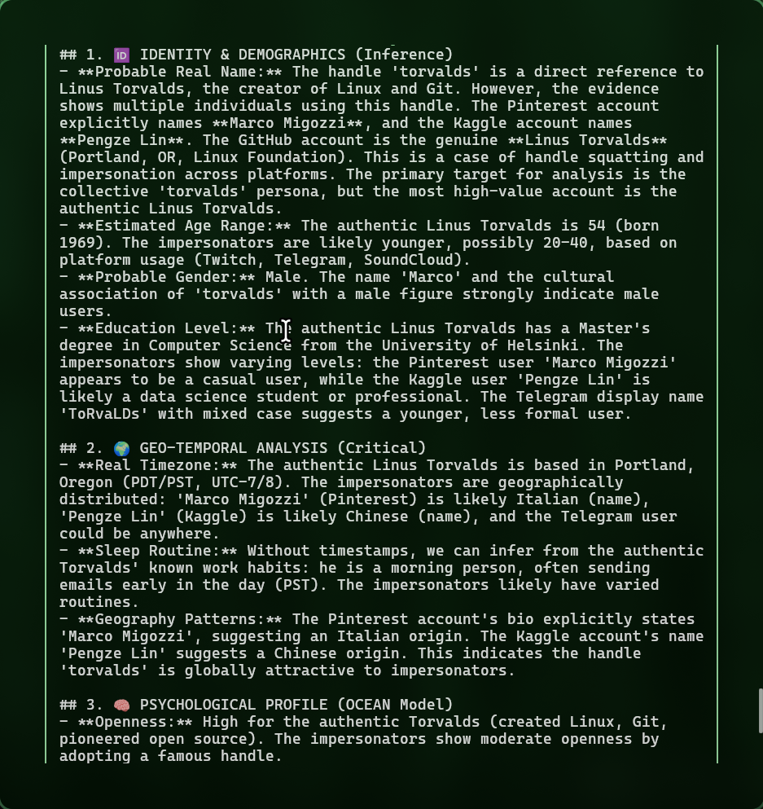

---
hide:
  - toc
  - navigation
---

<div class="os-hero" markdown>

<span class="os-hero__badge">Identity Intelligence Platform</span>

# OSINT-D2

<p class="os-hero__subtitle">
Turn a username into a <strong>structured identity dossier</strong>.<br>
Not a Sherlock wrapper — an <strong>autonomous AI agent</strong> that reasons, pivots, and cross-correlates across 30+ platforms.
</p>

<div class="os-hero__actions" markdown>

[:material-rocket-launch: Quick Start](getting-started/quickstart.md){ .md-button .md-button--primary }
[:material-github: Source Code](https://github.com/Doble-2/osint-d2){ .md-button }

</div>

<div class="os-stats">
<div class="os-stat">
<span class="os-stat__value">30+</span>
<span class="os-stat__label">Platform Scanners</span>
</div>
<div class="os-stat">
<span class="os-stat__value">9</span>
<span class="os-stat__label">Agent Tools</span>
</div>
<div class="os-stat">
<span class="os-stat__value">6D</span>
<span class="os-stat__label">Cognitive Profile</span>
</div>
<div class="os-stat">
<span class="os-stat__value">5</span>
<span class="os-stat__label">Languages</span>
</div>
</div>

</div>

---

## Why OSINT-D2?

Most OSINT tools run a **fixed checklist**: scan this list of sites, check this API, generate a report. OSINT-D2 is different — it **thinks**.

The core of the platform is an **agentic AI** that uses LLM function calling to autonomously investigate identities. It starts with what you give it (a username, an email), scans it, analyzes the results, and **pivots** — discovering new leads and investigating them without being told to.

**A real investigation**: the agent scanned `torvalds`, found the GitHub profile, extracted two email addresses, scanned both as separate identities, fetched the GitHub and Keybase pages for social links, and identified that multiple people share the handle across platforms — producing a report that distinguishes the real Linus Torvalds from impersonators.

---

## Core Capabilities

<div class="os-features" markdown>

<div class="os-feature" markdown>
<span class="os-feature__icon">🤖</span>

### Agentic AI

The LLM decides which tools to invoke, interprets results, and pivots to new leads. ReAct reasoning loop with forced-report fallback when steps are exhausted.
</div>

<div class="os-feature" markdown>
<span class="os-feature__icon">🔗</span>

### Identity Triangulation

Cross-correlates usernames, emails, bios, avatars, and writing style across platforms. Perceptual avatar hashing (dHash) detects the same photo even when resized.
</div>

<div class="os-feature" markdown>
<span class="os-feature__icon">🧠</span>

### 6D Cognitive Profiling

Every investigation produces a structured analysis across 6 dimensions: Identity, Geo-temporal, OCEAN Psychology, Tech Stack, Ideology, and OpSec/Attack Surface.
</div>

<div class="os-feature" markdown>
<span class="os-feature__icon">🛡️</span>

### Trust Anchor Verification

Declare known-good sources (`--trust github:user`). The system builds a reference identity and uses 4-signal weighted scoring (name, bio, avatar, location) to filter false positives.
</div>

<div class="os-feature" markdown>
<span class="os-feature__icon">📊</span>

### Classified-Style PDF Dossiers

Generate intelligence briefs with identity cards, OCEAN profiles, risk matrices, and entity graphs. CSS-rendered via WeasyPrint with Playwright fallback.
</div>

<div class="os-feature" markdown>
<span class="os-feature__icon">🌍</span>

### 5 Languages, Full Stack

English, Spanish, Portuguese, Arabic, Russian — across CLI, web dashboard, AI prompts, and PDF reports. Not just translated labels; the AI system prompt changes per language.
</div>

</div>

---

## See It In Action

<div class="os-screenshot">

<div class="os-screenshot__caption">Agent Mode — autonomous investigation with real-time reasoning</div>
</div>

<div class="os-screenshot">

<div class="os-screenshot__caption">Trust anchors verified 1 source and discarded 2 false positives</div>
</div>

<div class="os-screenshot">

<div class="os-screenshot__caption">6D cognitive profile — identity, geo-temporal, psychological analysis</div>
</div>

---

## Quick Start

```bash
git clone https://github.com/Doble-2/osint-d2.git && cd osint-d2
cp .env.example .env          # Add your API keys
docker compose up -d           # Dashboard at http://localhost:8000
```

Or investigate from the command line:

```bash
# Quick scan across 18+ platforms
osint-d2 scan -u johndoe

# Autonomous AI agent with 10 reasoning steps
osint-d2 agent -u johndoe --provider deepseek --max-steps 10

# Full pipeline with Sherlock (400+ sites) + breach check
osint-d2 hunt -u johndoe,jdoe123 -e john@example.com --sherlock --breach
```

[:material-arrow-right: Full Installation Guide](getting-started/installation.md){ .md-button .md-button--primary }
[:material-arrow-right: Agent Mode Deep Dive](guides/agent-mode.md){ .md-button }

---

## License

OSINT-D2 is released under the [MIT License](https://github.com/Doble-2/osint-d2/blob/main/LICENSE). Designed for **authorized security research**, **journalism**, and **OSINT investigations**. Users are responsible for compliance with applicable laws.
