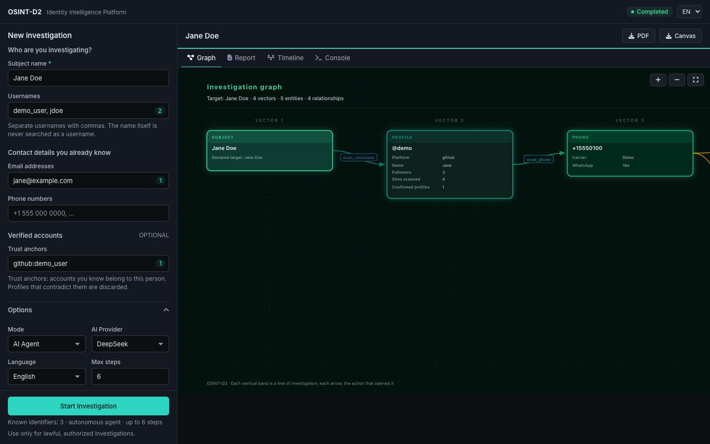

---
hide:
  - toc
  - navigation
---

<div class="os-hero" markdown>

<div markdown>

# OSINT-D2

<p class="os-hero__subtitle">
Investigate public identity data with an <strong>AI agent</strong> that follows leads and documents its evidence, or run <strong>direct scans</strong> with no AI at all.
</p>

<div class="os-hero__actions" markdown>

[Quick Start](getting-started/quickstart.md){ .md-button .md-button--primary }
[:material-github: Source Code](https://github.com/Doble-2/osint-d2){ .md-button }

</div>

</div>

<div class="os-hero__start" markdown>

<div class="os-hero__start-label">Start the dashboard with Docker</div>

```bash
git clone https://github.com/Doble-2/osint-d2.git && cd osint-d2
cp .env.example .env          # Add your AI key
mkdir -p reports
docker compose up -d          # Dashboard at http://localhost:8000
```

</div>

</div>

<div class="os-stats">
<div class="os-stat">
<span class="os-stat__value">24</span>
<span class="os-stat__label">Native scanners</span>
</div>
<div class="os-stat">
<span class="os-stat__value">9</span>
<span class="os-stat__label">Agent tools</span>
</div>
<div class="os-stat">
<span class="os-stat__value">6</span>
<span class="os-stat__label">Report areas</span>
</div>
<div class="os-stat">
<span class="os-stat__value">5</span>
<span class="os-stat__label">Languages</span>
</div>
</div>

!!! warning "Use it responsibly"
    Use OSINT-D2 only for lawful, authorized investigations. Results can be wrong, and scan results go to your AI provider unless you use Ollama. Read [Security & Responsible Use](guides/security.md).

## What it does

OSINT-D2 is a command-line tool and local dashboard. Direct scans use 20 username scanners and 4 email scanners, with optional Sherlock for about 470 more sites. The agent uses function calling to choose its next step: it scans what you give it, reads the results, and follows new leads such as emails and websites.

<div class="os-features" markdown>

<div class="os-feature" markdown>

:material-robot-outline:{ .os-feature__icon }

### Agentic AI

The model decides which tools to call, interprets the results, and pivots to new leads. If it runs out of steps, it is forced to write a report.

[Agent mode](guides/agent-mode.md)

</div>

<div class="os-feature" markdown>

:material-link-variant:{ .os-feature__icon }

### Identity Triangulation

Cross-correlates usernames, emails, bios, avatars, and writing style across platforms. Avatar hashing (dHash) detects the same photo even when resized.

[Architecture](architecture/overview.md)

</div>

<div class="os-feature" markdown>

:material-file-document-outline:{ .os-feature__icon }

### Six-Area Reports

Agent reports cover Identity, Geo-temporal, OCEAN Psychology, Tech Stack, Ideology, and OpSec/Attack Surface. The personality and ideology sections are speculative inferences.

[Security & responsible use](guides/security.md)

</div>

<div class="os-feature" markdown>

:material-shield-check-outline:{ .os-feature__icon }

### Trust Anchor Verification

Declare known-good sources (`--trust github:user`). Weighted scoring on name, bio, avatar, and location then filters out false positives.

[Trust anchors](architecture/trust-anchors.md)

</div>

<div class="os-feature" markdown>

:material-file-pdf-box:{ .os-feature__icon }

### PDF Dossiers

Generate reports with identity cards, profile analysis, risk matrices, and entity graphs. The CLI renders them with WeasyPrint, and the dashboard with Chromium.

[Web dashboard](guides/web-dashboard.md)

</div>

<div class="os-feature" markdown>

:material-translate:{ .os-feature__icon }

### Five Languages

English, Spanish, Portuguese, Arabic, and Russian in the CLI, web dashboard, profiler, and PDF reports.

[Language coverage](guides/languages.md)

</div>

</div>

## See it in action

<div class="os-gallery">

<div class="os-screenshot">
<a href="assets/dashboard-report.png"></a>
<div class="os-screenshot__caption">Finished agent investigation in the dashboard (demo data)</div>
</div>

<div class="os-screenshot">
<a href="assets/dashboard-graph.png"></a>
<div class="os-screenshot__caption">Investigation graph: each band is a line of inquiry (demo data)</div>
</div>

</div>

## Investigate from the command line

```bash
# Quick scan with the 20 username scanners, no AI
osint-d2 scan johndoe

# Autonomous AI agent with 10 reasoning steps
osint-d2 agent johndoe --ai-provider deepseek --max-steps 10

# Several targets with Sherlock (about 470 sites)
osint-d2 hunt -u johndoe,jdoe123 -e john@example.com --sherlock
```

[Installation guide](getting-started/installation.md){ .md-button .md-button--primary }
[CLI reference](guides/cli-reference.md){ .md-button }

## License

OSINT-D2 is released under the [MIT License](https://github.com/Doble-2/osint-d2/blob/main/LICENSE). It is designed for **authorized security research**, **journalism**, and **OSINT investigations**. You are responsible for complying with applicable laws.
